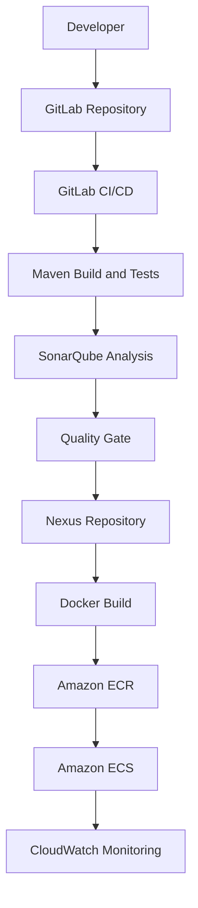

# End-to-End DevOps Platform

## 1. Project Description

This project demonstrates an end-to-end DevOps implementation using GitLab CI/CD to automate application building, testing, code quality analysis, artifact management, containerization, and deployment to AWS.

The platform integrates GitLab, GitLab CI/CD, Maven, SonarQube, Nexus Repository, Docker, Amazon ECR, and Amazon ECS to establish an automated CI/CD workflow.

## 2. Technology Badges


## 3. Project Objectives

- Implement automated CI/CD using GitLab.
- Automate application builds and unit testing using Maven.
- Integrate SonarQube for static code analysis.
- Enforce code quality through Quality Gates.
- Store build artifacts in Nexus Repository.
- Containerize applications using Docker.
- Push container images to Amazon ECR.
- Deploy applications to Amazon ECS.
- Monitor application health and performance using AWS CloudWatch.

## 4. Architecture Diagram



## 5. CI/CD Workflow

1. Developer pushes application code to GitLab.
2. GitLab detects the code changes and triggers the pipeline.
3. GitLab Runner executes the pipeline jobs.
4. Maven builds the application and runs unit tests.
5. SonarQube performs static code analysis.
6. The pipeline checks the SonarQube Quality Gate.
7. Build artifacts are published to Nexus Repository.
8. Docker builds the application image.
9. The image is pushed to Amazon ECR.
10. GitLab CI/CD deploys the application to Amazon ECS.
11. AWS CloudWatch monitors application logs and performance.

## 6. Technologies and Their Responsibilities

| Technology | Responsibility |
|---|---|
| Git | Source code version control |
| GitLab | Source code hosting and project management |
| GitLab CI/CD | Pipeline automation |
| GitLab Runner | Executes pipeline jobs |
| Maven | Application build and testing |
| SonarQube | Static code analysis |
| Nexus Repository | Artifact management |
| Docker | Containerization |
| Amazon ECR | Container image registry |
| Amazon ECS | Container deployment |
| AWS CloudWatch | Monitoring and logging |
| Prometheus/Grafana | Metrics monitoring and visualization, if implemented |

## 7. Project Folder Structure

```text
end-to-end-devops-platform/
│
├── .gitlab-ci.yml
├── docs/
│   ├── 01-project-overview.md
│   ├── 02-architecture.md
│   ├── 03-installation.md
│   ├── 04-cicd-pipeline.md
│   ├── 05-code-quality.md
│   ├── 06-artifact-management.md
│   ├── 07-docker-deployment.md
│   ├── 08-aws-deployment.md
│   ├── 09-monitoring.md
│   ├── 10-security.md
│   └── 11-troubleshooting.md
│
├── docker/
├── screenshots/
├── monitoring/
├── src/
├── .gitignore
└── README.md
```

## 8. Installation and Deployment Instructions

### Prerequisites

- Git
- Java JDK
- Maven
- Docker
- GitLab account
- GitLab Runner
- AWS CLI
- AWS account with appropriate permissions

### Clone the repository

```bash
git clone https://gitlab.com/YOUR-USERNAME/end-to-end-devops-platform.git

cd end-to-end-devops-platform
```

### Build the application locally

```bash
mvn clean package
```

### Build Docker image locally

```bash
docker build -t devops-platform .
```

### Run Docker container

```bash
docker run -d -p 8080:8080 --name devops-platform devops-platform
```

### Verify the container

```bash
docker ps
```

### GitLab CI/CD Configuration

The `.gitlab-ci.yml` file defines the automated pipeline stages, including:

- Build
- Test
- Code Quality
- Artifact Publishing
- Docker Build
- Container Image Publishing
- AWS Deployment

## 9. Project Documentation

| No. | Documentation | Description |
|---|---|---|
| 01 | [Project Overview](docs/01-project-overview.md) | Introduction and objectives |
| 02 | [Architecture](docs/02-architecture.md) | System architecture and workflow |
| 03 | [Installation](docs/03-installation.md) | Environment setup |
| 04 | [CI/CD Pipeline](docs/04-cicd-pipeline.md) | GitLab CI/CD pipeline |
| 05 | [Code Quality](docs/05-code-quality.md) | SonarQube and testing |
| 06 | [Artifact Management](docs/06-artifact-management.md) | Nexus repository |
| 07 | [Docker Deployment](docs/07-docker-deployment.md) | Containerization |
| 08 | [AWS Deployment](docs/08-aws-deployment.md) | Amazon ECR and ECS |
| 09 | [Monitoring](docs/09-monitoring.md) | Monitoring and logging |
| 10 | [Security](docs/10-security.md) | Security best practices |
| 11 | [Troubleshooting](docs/11-troubleshooting.md) | Common issues and solutions |

## 10. Screenshots and Project Results

Screenshots will be stored in the `screenshots/` directory.

Examples:

- GitLab project repository.
- GitLab CI/CD pipeline successful execution.
- GitLab Runner configuration.
- Maven build and test results.
- SonarQube Quality Gate results.
- Nexus artifact repository.
- Docker image build.
- Amazon ECR image repository.
- Amazon ECS service running.
- CloudWatch application logs.

## 11. Project Status

This project is being developed incrementally. Completed components, pipeline executions, and deployment results will be documented as implementation progresses.

