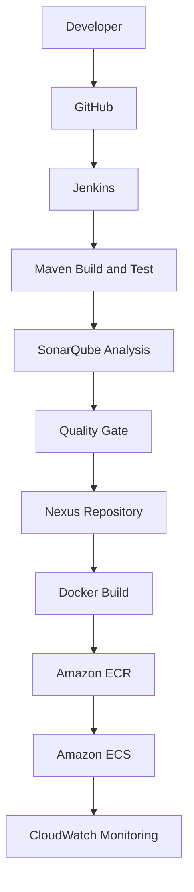

# End-to-End DevOps Platform

## 1. Project Description

This project demonstrates an end-to-end DevOps implementation that automates the software build, testing, code quality analysis, containerization, and deployment process.

The platform integrates GitHub, Jenkins, Maven, SonarQube, Nexus, Docker, Amazon ECR, and Amazon ECS to establish an automated CI/CD workflow.

## 2. Technology Badges


## 3. Project Objectives

- Automate application build and testing.
- Implement continuous integration and continuous delivery.
- Perform static code analysis using SonarQube.
- Manage build artifacts using Nexus Repository.
- Containerize applications using Docker.
- Deploy container images to Amazon ECS using Amazon ECR.
- Monitor application health and performance.

## 4. Architecture Diagram

The platform follows this deployment workflow:



## 5. CI/CD Workflow

1. Developer pushes code to GitHub.
2. GitHub webhook triggers Jenkins.
3. Jenkins checks out the source code.
4. Maven builds the application and runs tests.
5. SonarQube performs static code analysis.
6. Jenkins checks the SonarQube Quality Gate.
7. Build artifacts are published to Nexus.
8. Docker builds the application image.
9. The image is pushed to Amazon ECR.
10. Amazon ECS deploys the application.
11. CloudWatch monitors application logs and performance.

## 6. Technologies and Their Responsibilities

| Technology | Responsibility |
|---|---|
| Git/GitHub | Source code management |
| Jenkins | CI/CD automation |
| Maven | Application build and testing |
| SonarQube | Code quality analysis |
| Nexus | Artifact management |
| Docker | Containerization |
| Amazon ECR | Container image registry |
| Amazon ECS | Container deployment |
| AWS CloudWatch | Monitoring and logging |
| Prometheus/Grafana | Metrics monitoring and visualization, if implemented |

## 7. Project Folder Structure

```text
end-to-end-devops-platform/
│
├── docs/
│   ├── 01-project-overview.md
│   ├── 02-architecture.md
│   ├── 03-installation.md
│   ├── 04-cicd-pipeline.md
│   ├── 05-code-quality.md
│   ├── 06-artifact-management.md
│   ├── 07-docker-deployment.md
│   ├── 08-aws-deployment.md
│   ├── 09-monitoring.md
│   ├── 10-security.md
│   └── 11-troubleshooting.md
│
├── docker/
├── jenkins/
├── monitoring/
├── screenshots/
├── src/
├── .gitignore
└── README.md
```

## 8. Installation and Deployment Instructions

### Prerequisites

- Git
- Java JDK
- Maven
- Docker
- Jenkins
- AWS CLI
- AWS account with appropriate permissions

### Clone the repository

```bash
git clone https://github.com/YOUR-GITHUB-USERNAME/end-to-end-devops-platform.git

cd end-to-end-devops-platform
```

### Build the application

```bash
mvn clean package
```

### Build Docker image

```bash
docker build -t devops-platform .
```

### Run Docker container

```bash
docker run -d -p 8080:8080 --name devops-platform devops-platform
```

### Verify the container

```bash
docker ps
```

*Note: These commands are examples. Adjust them to match your actual application, Dockerfile, and deployment configuration.*

## 9. Project Documentation

Detailed documentation is available below:

| No. | Documentation | Description |
|---|---|---|
| 01 | [Project Overview](docs/01-project-overview.md) | Introduction and objectives |
| 02 | [Architecture](docs/02-architecture.md) | Architecture and system workflow |
| 03 | [Installation](docs/03-installation.md) | Environment setup |
| 04 | [CI/CD Pipeline](docs/04-cicd-pipeline.md) | Jenkins pipeline configuration |
| 05 | [Code Quality](docs/05-code-quality.md) | SonarQube and testing |
| 06 | [Artifact Management](docs/06-artifact-management.md) | Nexus repository |
| 07 | [Docker Deployment](docs/07-docker-deployment.md) | Containerization |
| 08 | [AWS Deployment](docs/08-aws-deployment.md) | Amazon ECR and ECS |
| 09 | [Monitoring](docs/09-monitoring.md) | Monitoring and logging |
| 10 | [Security](docs/10-security.md) | Security best practices |
| 11 | [Troubleshooting](docs/11-troubleshooting.md) | Common issues and solutions |

## 10. Screenshots and Project Results

Screenshots demonstrating the implementation will be stored in the `screenshots/` directory.

Examples to include:

- Jenkins pipeline successful build.
- Maven build and test results.
- SonarQube quality gate results.
- Nexus artifact repository.
- Docker container running.
- Amazon ECR image repository.
- Amazon ECS service running.
- CloudWatch application logs.

<!-- Add screenshots here as you implement each stage. -->

## 11. Project Status

This project is being developed incrementally. Completed components and deployment results will be documented as implementation progresses.

