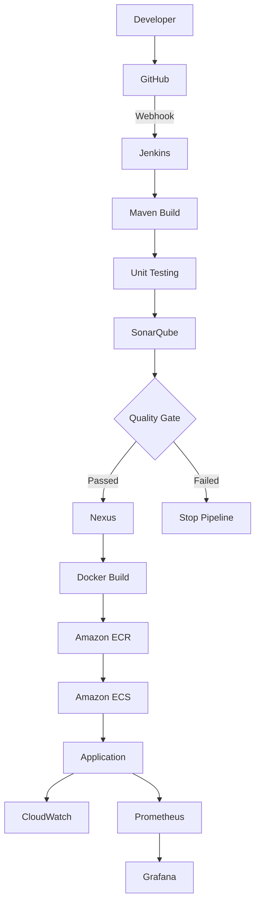

# 2. System Architecture

## 2.1 Architecture Overview

The End-to-End DevOps Platform follows a Continuous Integration and Continuous Delivery architecture.

The platform connects source code management, automated builds, code quality analysis, artifact storage, containerization, cloud deployment, and monitoring.

## 2.2 Architecture Components

### GitHub

GitHub is used to store and manage application source code.

Developers push code changes to the repository, triggering the Jenkins pipeline through a configured webhook.

### Jenkins

Jenkins is the central automation server responsible for executing CI/CD pipeline stages.

It coordinates application builds, testing, code analysis, artifact publishing, Docker image creation, and deployment.

### Maven

Maven manages application dependencies, compilation, testing, and packaging.

### SonarQube

SonarQube performs static code analysis to identify bugs, vulnerabilities, and maintainability issues.

### Nexus

Nexus Repository Manager stores application build artifacts and provides centralized artifact management.

### Docker

Docker packages the application and its runtime dependencies into portable container images.

### Amazon ECR

Amazon Elastic Container Registry stores Docker images used for application deployment.

### Amazon ECS

Amazon Elastic Container Service manages the deployment and execution of application containers.

### Monitoring

CloudWatch, Prometheus, and Grafana provide infrastructure and application monitoring capabilities.

## 2.3 Application Delivery Workflow

1. Developers push source code to GitHub.
2. GitHub sends a webhook notification to Jenkins.
3. Jenkins checks out the application source code.
4. Maven builds and tests the application.
5. SonarQube performs code quality analysis.
6. Jenkins evaluates the quality gate.
7. Successful build artifacts are published to Nexus.
8. Docker builds the application image.
9. The image is pushed to Amazon ECR.
10. Jenkins deploys the application to Amazon ECS.
11. Application health checks verify deployment status.
12. Monitoring tools collect metrics and logs.

## 2.4 Architecture Diagram

## 2.5 Architecture Benefits

- Automated application delivery.
- Consistent build environments.
- Improved software quality.
- Centralized artifact storage.
- Portable application containers.
- Scalable cloud deployment.
- Improved operational visibility.

## 2.6 Conclusion

The architecture provides an integrated approach to application development, testing, deployment, and monitoring using modern DevOps technologies.
