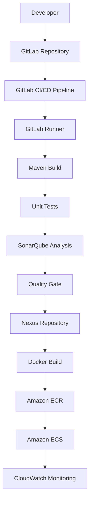

# 04 - CI/CD Pipeline with GitLab

## 1. Introduction

This document explains how GitLab CI/CD is used to automate the software development and deployment lifecycle in the End-to-End DevOps Platform.

GitLab CI/CD provides an automated process for building, testing, analyzing, packaging, and deploying applications.

The pipeline is configured using a `.gitlab-ci.yml` file located in the root directory of the project.

GitLab Runner executes the jobs defined in the pipeline configuration.

## 2. GitLab CI/CD Architecture

The CI/CD pipeline integrates the following technologies:

- GitLab: Source code management and CI/CD orchestration.
- GitLab Runner: Executes pipeline jobs.
- Maven: Builds and tests the Java application.
- SonarQube: Performs static code analysis.
- Nexus Repository: Stores build artifacts.
- Docker: Builds container images.
- Amazon ECR: Stores Docker images.
- Amazon ECS: Runs the containerized application.
- AWS CloudWatch: Provides application monitoring and logging.

### Pipeline Architecture Diagram



## 3. CI/CD Pipeline Workflow

### Stage 1: Source Code Management

Developers maintain application source code in GitLab.

When a developer pushes new code to the repository, GitLab detects the changes and triggers the configured pipeline.

### Stage 2: GitLab CI/CD Pipeline

GitLab CI/CD reads the `.gitlab-ci.yml` configuration file and creates the pipeline stages and jobs.

The pipeline automates the build, testing, quality analysis, artifact publishing, containerization, and deployment processes.

### Stage 3: GitLab Runner

GitLab Runner is responsible for executing the pipeline jobs.

It can run using different executors, including Docker and Shell.

For this project, the Runner must have access to the tools and services required by the pipeline.

### Stage 4: Maven Build

Maven compiles the Java application, resolves dependencies, and packages the application.

Example command:

```bash
mvn clean package
```

### Stage 5: Unit Testing

Maven executes the application's unit tests to verify that the code behaves as expected.

Example command:

```bash
mvn test
```

Test results are generated in the Maven `target/surefire-reports` directory.

### Stage 6: SonarQube Code Analysis

SonarQube analyzes the source code to identify:

- Bugs
- Code smells
- Security vulnerabilities
- Code duplication
- Maintainability issues

The pipeline can use the SonarQube Quality Gate to prevent code that fails the configured quality criteria from progressing.

### Stage 7: Nexus Artifact Management

After a successful build and quality check, Maven can publish the generated application artifact to Nexus Repository.

Nexus provides centralized storage and management of application build artifacts.

### Stage 8: Docker Image Build

Docker packages the application and its runtime dependencies into a container image.

Example command:

```bash
docker build -t devops-platform .
```

### Stage 9: Amazon ECR

The generated Docker image is tagged and pushed to Amazon Elastic Container Registry (ECR).

Amazon ECR provides a managed registry for storing and retrieving container images.

### Stage 10: Amazon ECS Deployment

GitLab CI/CD deploys the container image to Amazon Elastic Container Service (ECS).

ECS runs and manages the application containers.

### Stage 11: Monitoring

AWS CloudWatch collects application logs, metrics, and monitoring information to help identify performance and availability issues.

## 4. GitLab CI/CD Configuration

The `.gitlab-ci.yml` file is stored in the root directory of the repository.

It defines:

- Pipeline stages.
- Jobs and scripts.
- Execution conditions.
- Build artifacts.
- Dependencies between jobs.
- Environment variables.

Example pipeline structure:

```yaml
stages:
  - build
  - test
  - quality
  - package
  - docker
  - deploy

build_application:
  stage: build
  script:
    - mvn clean compile

run_tests:
  stage: test
  script:
    - mvn test

sonarqube_analysis:
  stage: quality
  script:
    - mvn sonar:sonar

package_application:
  stage: package
  script:
    - mvn package
  artifacts:
    paths:
      - target/

docker_build:
  stage: docker
  script:
    - docker build -t devops-platform .

deploy_application:
  stage: deploy
  script:
    - echo "Configure AWS ECS deployment here"
  when: manual
```

**Note:** This is an introductory pipeline structure, not a complete production-ready configuration. It assumes a Runner with Maven and Docker available, and a configured SonarQube integration. AWS deployment, Nexus publishing, authentication, and image pushing still need to be configured.

## 5. GitLab CI/CD Variables and Secrets

Sensitive credentials should be stored in GitLab CI/CD Variables rather than hardcoded in the pipeline.

Examples:

| Variable | Purpose |
|---|---|
| SONAR_HOST_URL | SonarQube server URL |
| SONAR_TOKEN | SonarQube authentication |
| NEXUS_URL | Nexus repository URL |
| NEXUS_USERNAME | Nexus username |
| NEXUS_PASSWORD | Nexus password |
| AWS_ACCESS_KEY_ID | AWS access key, if using IAM user credentials |
| AWS_SECRET_ACCESS_KEY | AWS secret key, if using IAM user credentials |
| AWS_DEFAULT_REGION | AWS deployment region |
| AWS_ACCOUNT_ID | AWS account ID |

Where possible, use GitLab protected and masked variables and AWS IAM role-based authentication instead of long-lived AWS access keys.

## 6. Pipeline Execution and Verification

To verify the pipeline:

1. Push a code change to GitLab.
2. Open the GitLab project.
3. Navigate to Build > Pipelines.
4. Select the latest pipeline.
5. Review each job's execution status.
6. Inspect job logs for errors.
7. Confirm that successful builds produce the expected artifacts and container images.
8. Verify the application deployment in Amazon ECS.

## 7. Expected Results

A successfully implemented pipeline should provide:

- Automated application builds.
- Automated unit testing.
- Automated code quality analysis.
- Controlled artifact publishing.
- Docker image creation.
- Container image publishing to Amazon ECR.
- Automated or controlled ECS deployment.
- Application monitoring through CloudWatch.

## 8. Conclusion

GitLab CI/CD provides the automation foundation for the End-to-End DevOps Platform.

By integrating GitLab Runner, Maven, SonarQube, Nexus, Docker, Amazon ECR, and Amazon ECS, the project establishes a repeatable software delivery workflow that improves deployment consistency, automation, and application quality.

